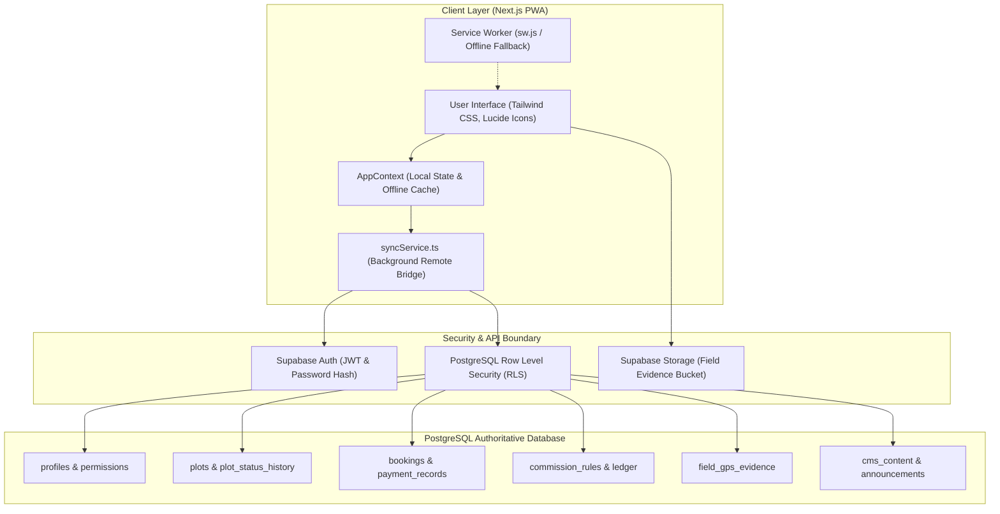
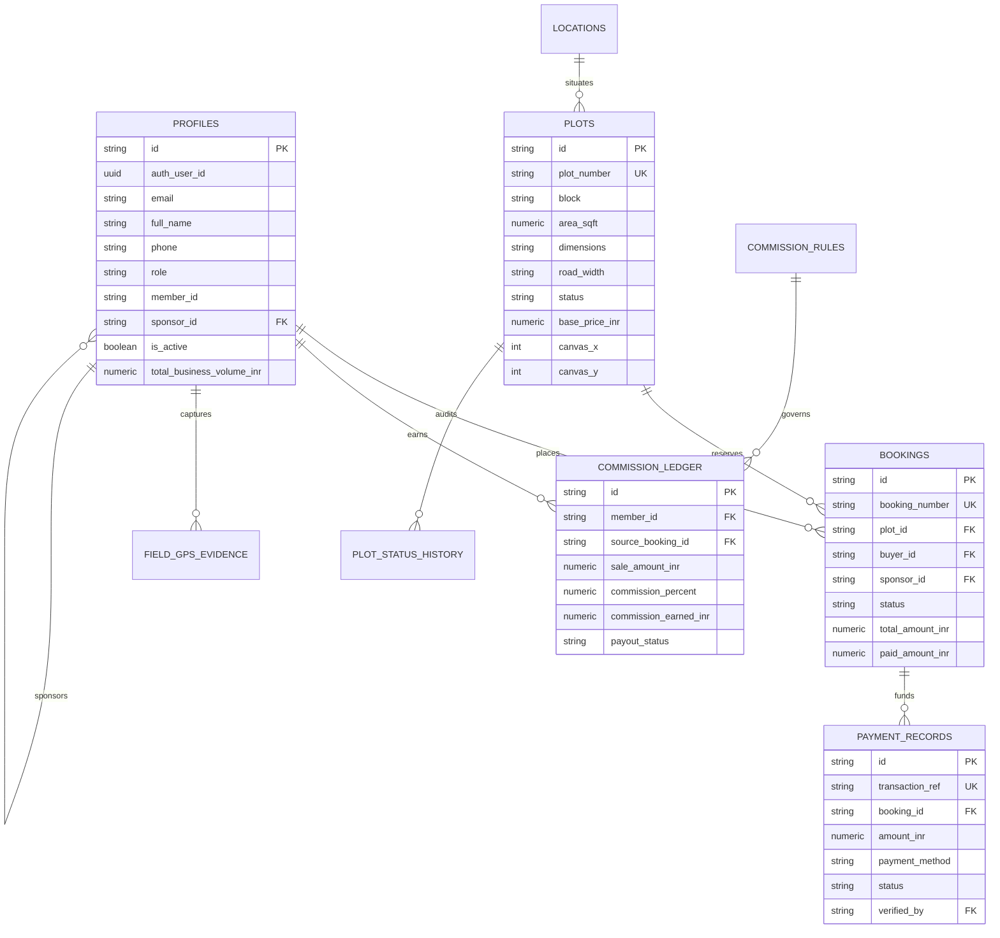

# AKGV INFRA CITY — SYSTEM ARCHITECTURE
**Document**: Technical Architecture, Domain Model & Data Flow  
**Entity**: AKGV Infra City Private Limited  
**Status**: Production Standard  

---

## 1. Architectural Overview

AKGV Infra City is structured as a modern **Decoupled Client-Cloud Architecture** utilizing Next.js (App Router, React 19, TypeScript) as the presentation layer, backed by **Supabase PostgreSQL & Auth** as the trusted security and data persistence engine.

---

## 2. Layer Responsibilities

### 2.1 Presentation & PWA Layer (`src/app`, `src/components`)
- **Rendering Strategy**: Next.js App Router with client components for interactive real-time controls (3D Viewer, Blueprint SVG Canvas, GPS Camera, Plot Grid).
- **Offline Reliability**: Service Worker caches shell assets (`offline.html`, icons, manifest). Critical user actions execute with immediate optimistic feedback, buffered locally, and synced in the background.
- **Multilingual Support**: Dictionary-backed internationalization (`src/lib/i18n.ts`) supporting English, Hindi (हिंदी), and Hinglish (Colloquial Hindi-English).

### 2.2 Application State & Sync Layer (`src/context/AppContext.tsx`, `src/lib/supabase/syncService.ts`)
- Manages in-memory reactive state for UI responsiveness.
- Bridges client actions to Supabase with automatic type mapping (camelCase to snake_case).
- Handles network interruptions gracefully without unhandled exceptions.

### 2.3 Trusted Server & Database Boundary (Supabase PostgreSQL + Auth)
- **Authentication**: Email/Phone and secure password authentication managed via Supabase Auth with bcrypt hashing and signed JWT tokens.
- **Row Level Security (RLS)**: Enforces table-level access rules directly in the database engine based on `auth.uid()` and verified `profiles.role`.
- **Financial Integrity**: All financial fields use PostgreSQL `NUMERIC` for decimal-safe monetary calculations.

---

## 3. Core Domain Entities & Relational Schema

---

## 4. Technical Constraints & Design Principles
1. **Zero Client Security Boundaries**: No client-side hidden button or local storage flag constitutes authorization. Permissions are verified at the database level via Postgres RLS.
2. **Idempotent Financial Operations**: Every payment, booking, and commission entry carries an immutable reference preventing duplicate creation on network retries.
3. **Audited Lifecycle Transitions**: Status changes (Plot availability, Payment verification, Member hierarchy changes) record actor ID, previous status, new status, and timestamp.
