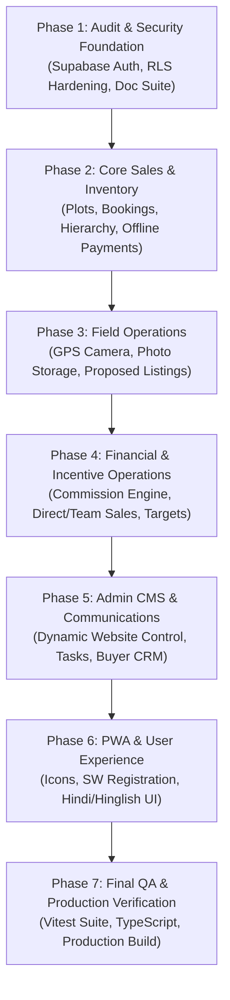

# AKGV INFRA CITY — ENTERPRISE IMPLEMENTATION PLAN
**Platform**: Production-Ready Real Estate Plotting, Sales Management, Member Network, Admin CMS & PWA  
**Corporate Entity**: AKGV Infra City Private Limited, Varanasi, Uttar Pradesh  
**Last Updated**: October 2026  
**Status**: Active Production Execution  

---

## 1. Executive Summary & Objective

AKGV Infra City Private Limited requires a secure, auditable, high-performance web platform and Progressive Web App (PWA) to govern land plot sales, associate/member networks, offline financial collections, field GPS evidence, and administrative operations across Varanasi corridors (Rampur, Lahartara, and Mirza Murad).

This document establishes the phased engineering roadmap to transition the codebase from a hybrid prototype to an enterprise-grade platform with:
- Strict Supabase Authentication and database-enforced Row Level Security (RLS).
- Zero reliance on client-side security boundaries or hardcoded privileged credentials.
- Real offline-first cash, UPI, and cheque ledger tracking with multi-stage verification.
- Dynamic CMS allowing non-technical corporate staff to update homepage copy, prices, announcements, and FAQs without touching code.
- Fully registered installable PWA with offline fallback and update notifications.

---

## 2. Baseline Audit Findings & Remediations

| # | Known Defect / Security Finding | Baseline State | Required Production Remediation |
|---|----------------------------------|----------------|----------------------------------|
| 1 | Insecure Authentication | Password bypassed; any identifier logged in. | Implement genuine Supabase Auth (`signInWithPassword`, `signUp`, `resetPasswordForEmail`). Enforce password verification. |
| 2 | Default Super Admin Profile | `currentUser` initialized to `DEMO_PROFILES[0]` (Super Admin). | Default unauthenticated state to `null`. Protected routes require verified session tokens. |
| 3 | Insecure Role-Switching Helper | `switchUserRole` allowed arbitrary client-side impersonation. | Disallow role switching for ordinary sessions. Role is strictly sourced from verified database `profiles.role`. |
| 4 | Overly Permissive RLS Policies | `FOR ALL TO anon, authenticated USING (true)` in previous schema. | Implement granular, least-privilege RLS policies based on `auth.uid()` and verified profile role. |
| 5 | Demo/Production State Confusion | Hardcoded demo accounts treated as active users. | Partition sandbox/demo data from authoritative Supabase records. Visual banner when running in demo sandbox. |
| 6 | Unpersisted Business Modules | Enquiries, CMS settings, and target progress stored in ephemeral state. | Connect all modules to authoritative PostgreSQL tables via `syncService.ts`. |
| 7 | Static Export vs Server Boundary | `output: 'export'` prevented dynamic server handlers. | Architecture configured for hybrid dynamic deployment while maintaining client-side PWA capability. |
| 8 | Unregistered Service Worker | `public/sw.js` existed but was never registered by `layout.tsx`. | Register SW with update lifecycle listener and network-first navigation fallback. |
| 9 | Missing PWA Icons | `manifest.json` pointed to missing 192px and 512px PNGs. | Generate valid PNG icons in `public/icons/` with proper MIME types and maskable support. |
| 10 | Unbounded GPS Evidence Storage | Photos saved as huge raw base64 data URLs in React state. | Store photo metadata and references in Supabase Storage (`field-evidence`) with file size validation. |

---

## 3. Seven-Phase Implementation Roadmap

### Phase 1: Security Foundation & Database Hardening
- Complete technical documentation suite in `docs/`.
- Replace bypass login with genuine Supabase Auth and password verification.
- Re-architect `AppContext.tsx` to initialize unauthenticated users to `null` with secure role-based route guards.
- Implement least-privilege PostgreSQL Row Level Security (RLS) policies.

### Phase 2: Core Sales Operations, Team Hierarchy & Offline Payments
- Enforce strict member-sponsor downline hierarchy with circular reference detection.
- Provide comprehensive plot lifecycle: `available_green`, `hold_pending`, `booked_yellow`, `vacant_red`, `sold`.
- Implement offline payment ledger for Cash (₹999 joining kit + plot booking), direct UPI with UTR reference, and Cheque with clearance tracking.
- Build Admin Sales, Team Attribution, and Location-wise Performance reports with CSV export.

### Phase 3: Field Operations & Inspection Storage
- Connect `FieldGpsCameraCapture` to Supabase Storage with photo compression and metadata validation.
- Capture GPS coordinates, reported accuracy, timestamp, boundary pillars, and proposed rate.
- Build Admin Inspection Approval Queue: Approved submissions can convert directly into live plot inventory.

### Phase 4: Financial & Incentive Engine
- Implement auditable commission ledger with immutable policy versioning.
- Track Direct Sales versus Downline Team Sales attribution.
- Configure Monthly/Quarterly Targets and real-time progress calculations for members.

### Phase 5: Admin CMS, Task Center & Buyer Portal
- Build dynamic CMS allowing Admin to edit homepage banners, headlines, project descriptions, notices, and FAQs without touching source code.
- Implement "Aaj ke Kaam" (Daily Task Center) and targeted in-app messaging.
- Build secure Buyer Portal: verified buyers access only their own plot certificates, verified receipts, and payment schedules.

### Phase 6: PWA & Accessible Multilingual UX
- Generate valid 192x192 and 512x512 PWA icons and register `sw.js` with update detection.
- Ensure seamless multilingual support (Hindi, Hinglish, English) with large readable touch targets.

### Phase 7: Verification & Production Release
- Run automated unit and integration tests (Vitest).
- Run TypeScript compile check and Next.js production build.
- Document deployment variables, first-admin bootstrap, and backup procedures.
